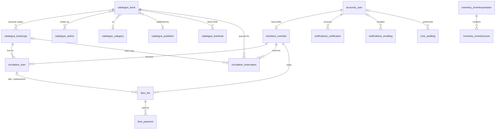

# Database schema

PostgreSQL in production (SQLite works for development and very small
libraries). The schema is created and upgraded by Django migrations
(`python manage.py migrate`) — never by hand.

## Entity relationships

## Tables

| Table | Purpose | Key constraints / indexes |
|---|---|---|
| `accounts_user` | One account per person; `role` = member / assistant / librarian / admin. Passwords are Argon2 hashes. | `email` unique (nullable for members without email) · index on `role` |
| `accounts_ratelimitevent` | Failed sign-ins etc., shared by all workers for rate limiting. | index (`key`, `created_at`) |
| `members_member` | Library profile: member ID (`LIB-2026-00482`), phone, address, status (active / suspended / inactive). | `member_id` unique · `user` one-to-one |
| `catalogue_book` | A **title**: metadata, cover, loan-period override, reference-only flag, denormalised `search_text`. | `slug` unique · `isbn` unique when present · index (`is_archived`, `created_at`) · PostgreSQL trigram GIN index on `search_text` |
| `catalogue_bookcopy` | A **physical copy**: barcode, copy ID (`LIB-HOB-00031`), shelf, condition, status. | `barcode` unique · `copy_code` unique · (`book`, `copy_number`) unique · status check constraint · index (`book`, `status`) |
| `catalogue_author`, `catalogue_category`, `catalogue_publisher` | Lookup tables. Categories carry a shelf code for the Shelf Finder. | names unique |
| `catalogue_booktrait` | Optional "Book DNA" scores (1–10). | (`book`, `name`) unique |
| `circulation_loan` | A borrowing; the return is recorded on the same row (`returned_at`, `returned_by`) so no separate *returns* table is needed. | **only one active loan per copy** (partial unique index) · indexes (`member`, `status`), (`status`, `due_date`) |
| `circulation_reservation` | FIFO queue per title; status waiting / ready / collected / expired / cancelled. | **one open reservation per member and title** · **one ready hold per copy** (partial unique indexes) · index (`book`, `status`, `created_at`) |
| `fees_fee` | Late, replacement, damage or other fees; status pending / paid / waived; supports partial payment. | amount ≥ 0 check · index (`member`, `status`) |
| `fees_payment` | Payments (method, date, receipt/reference; `provider` reserved for online gateways). | amount > 0 check |
| `notifications_notification` | In-app notification centre. | index (`user`, `read_at`) · `dedupe_key` unique |
| `notifications_emaillog` | Every email: rendered content, status, attempts, error. Password/verification links are never stored. | `dedupe_key` unique (reminders are sent once) |
| `notifications_announcement` | Library-wide announcements. | — |
| `inventory_inventorysession`, `inventory_inventoryscan` | Inventory mode sessions and each scan's result. | index (`session`, `copy`) |
| `core_librarysettings` | Single row (pk = 1) with everything an administrator configures. | — |
| `core_auditlog` | Who did what and when for important staff actions, with field-level changes. | index on `created_at`, `action`, (`target_type`, `target_id`) |

Django's own tables (`django_session`, `django_migrations`,
`auth_permission`, `django_content_type`) are also present.

## States

| Object | States |
|---|---|
| Copy | Available · Borrowed · Reserved (on hold shelf) · Maintenance · Damaged · Lost · Withdrawn |
| Loan | On loan · Returned · Lost |
| Reservation | Waiting · Ready for collection · Collected · Expired · Cancelled |
| Member | Active · Suspended · Inactive |
| Fee | Pending · Paid · Waived |

## Integrity guarantees enforced by the database

* A copy can never be on two active loans (partial unique index), even if
  two desks scan it at the same instant — the second gets a friendly
  "This copy was just checked out at another desk."
* A barcode can never be registered twice.
* A member can't hold two open reservations for the same title, and a copy
  can't be held for two people.
* Money can't go negative.
